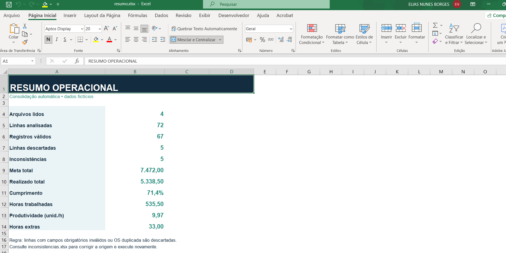
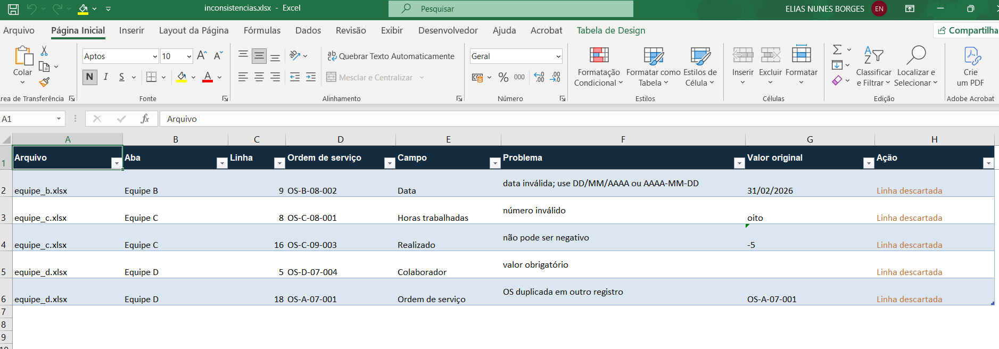
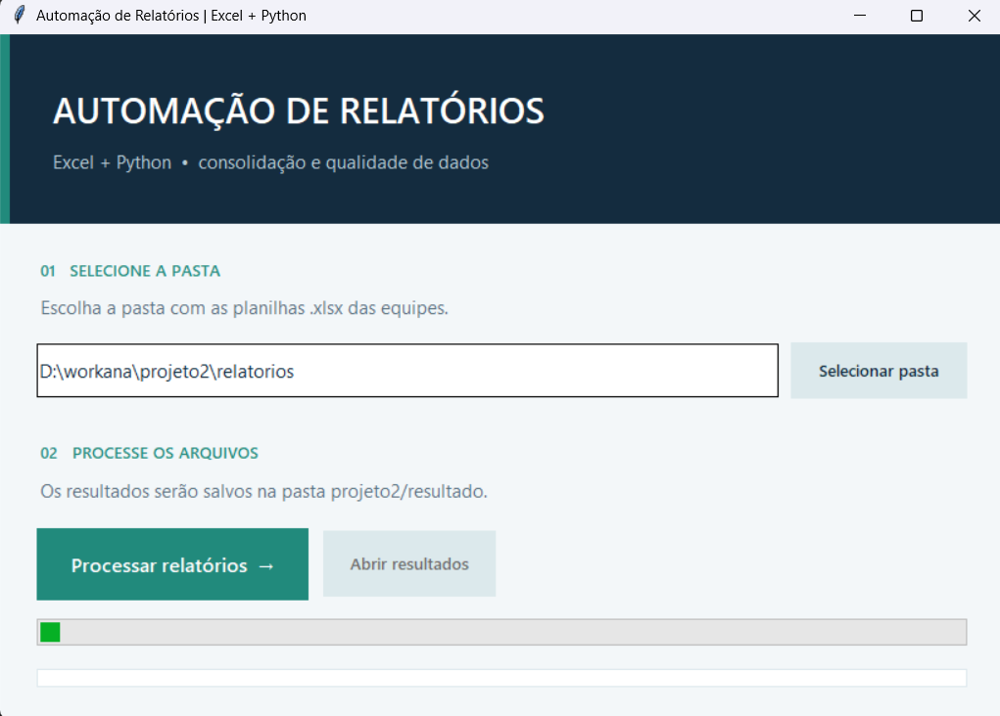

# Automação de Relatórios com Excel + Python


Projeto de portfólio com dados **fictícios**. Simula a rotina mensal de uma empresa que recebe planilhas de quatro equipes, precisa padronizar os dados, consolidar a operação e encontrar erros antes de publicar o relatório.

```text
relatorios/equipe_*.xlsx
        ↓ leitura, padronização e validação
consolidar.py
        ↓
resultado/consolidado.xlsx
resultado/inconsistencias.xlsx
resultado/resumo.xlsx
```

## Capturas da demonstração

As imagens abaixo mostram o fluxo real da ferramenta com os dados fictícios incluídos neste repositório.

**Resumo operacional:** quatro arquivos lidos, 72 linhas analisadas, 67 registros válidos e cinco inconsistências.

[](imagens/resumo-operacional.png)

**Inconsistências:** cada linha descartada é acompanhada do arquivo, campo, motivo e ação.

[](imagens/inconsistencias.png)

**Interface:** seleção da pasta de entrada e processamento dos relatórios.

[](imagens/interface-automacao-relatorios.png)

## Como usar

1. Instale Python 3.10 ou superior e execute `pip install -r requirements.txt` uma vez.
2. No Windows, dê dois cliques em **`abrir_interface.bat`**.
3. Selecione a pasta que contém os relatórios `.xlsx` (a pasta `relatorios` já vem selecionada).
4. Clique em **Processar relatórios**. O botão **Abrir resultados** leva aos três arquivos gerados em `resultado`.

Também é possível executar pelo terminal:

```powershell
python consolidar.py
python consolidar.py --entrada "C:\caminho\relatorios" --saida "C:\caminho\resultado"
```

Para recriar as quatro planilhas fictícias: `python gerar_exemplos.py`. Esse comando substitui os arquivos `equipe_a.xlsx` a `equipe_d.xlsx` da pasta de exemplos.

Para verificar o fluxo com uma entrada de teste independente: `python -m unittest discover -s tests -v`.

## Arquivos do projeto

| Arquivo | Função |
| --- | --- |
| `relatorios/equipe_a.xlsx` a `equipe_d.xlsx` | Dados de exemplo com 72 linhas, cabeçalhos e formatos variados |
| `consolidar.py` | Leitura, validação, padronização e geração dos relatórios |
| `interface.py` | Interface gráfica com seleção de pasta, processamento e resumo |
| `abrir_interface.bat` | Atalho para abrir a interface no Windows |
| `gerar_exemplos.py` | Geração reproduzível das planilhas de demonstração |
| `resultado/consolidado.xlsx` | 67 registros válidos, com arquivo, aba e linha de origem |
| `resultado/inconsistencias.xlsx` | 5 linhas com erros, motivo, valor original e ação |
| `resultado/resumo.xlsx` | Indicadores gerais e análises por equipe, serviço e mês, com gráficos |

## Regras de processamento

- Lê todos os arquivos `.xlsx` da pasta selecionada e ignora arquivos temporários do Excel (`~$`).
- Reconhece nomes alternativos de colunas, como `OS`/`Ordem de serviço`, `Produção`/`Realizado` e `Unidade`/`Local`.
- Padroniza datas nos formatos `DD/MM/AAAA`, `AAAA-MM-DD` e `DD-MM-AAAA`; números com vírgula decimal; nomes de equipe, serviço e status.
- Exige data, ordem de serviço, equipe, serviço, local, colaborador e status válidos. Meta, realizado e horas extras não podem ser negativos; horas trabalhadas devem ser maiores que zero.
- Descarta ordens de serviço duplicadas. Uma linha inválida não entra no consolidado nem no resumo; cada problema encontrado é descrito em `inconsistencias.xlsx`.
- Calcula cumprimento como **realizado ÷ meta** e produtividade como **realizado ÷ horas trabalhadas**. Se o denominador for zero, o indicador é exibido como zero.

Os cinco problemas intencionais da demonstração são: data impossível, horas em texto, realizado negativo, colaborador ausente e ordem de serviço duplicada. O processamento de exemplo termina com **4 arquivos lidos, 72 linhas analisadas, 67 válidas e 5 descartadas**.

Os arquivos da pasta `resultado` são atualizados a cada execução. Mantenha-os fechados no Excel durante o processamento.
